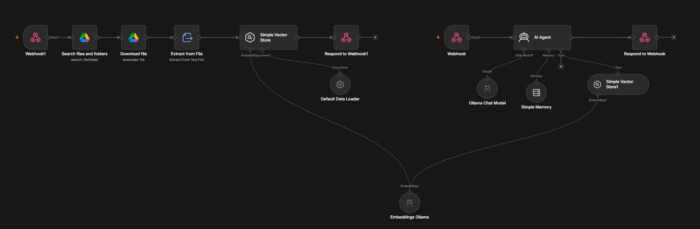

# Docker Q&A chatbot :  Python RAG pipeline vs n8n AI agent

## Description 

This project builds 2 question answering chatbots, one as a python RAG pipeline and one as an n8n AI agent, and compares them on a small dataset of questions about docker. Both systems use the same documents, the same embedding model, the same chat model (Llama 3.2), the same chunking (1000 characters, 200 overlap), and the same prompt rules.

The goal is to compare a coded pipeline with a low-code agent when both run on small, free, local models, and to see what each one does when the answer is not in the documents.

## Data :

- Source : the "get-started" section of the Docker documentation : https://github.com/docker/docs/tree/main/content/get-started
- The files are copyright Docker, Inc., licensed under Apache 2.0 (a copy of the license is in 'raw data/LICENSE'). They were modified : the metadata and some tags were removed. The image files are not included, only the image links remain in the text. Downloaded around mid october 2026
- Questions and reference answers: "q&a/q&a.csv"


## Python pipeline : 

- Chunks of 1000 characters with 200 overlap, embedded with nomic-embed-text through Ollama.
- FAISS search (cosine similarity), top 3 passages, using the user's question as the query.
- Llama 3.2 answers with a strict prompt. Memory of the last 3 exchanges goes into the prompt.


## n8n pipeline :



- **Loading flow :** webhook, google drive search, download, text extraction, default data loader (same 1000/200 splitting), Ollama embeddings, in-memory vector store.
- **Question flow :** webhook, AI agent (Llama 3.2) with the vector store as a search tool (top 3), memory (window of 3, session ID from the request), response.
- The workflow is in 'n8n/workflow.json'.

Note : you need to use your credentials and the workflow needs to be published

## Evaluation : 
- 20 questions : 15 answerable questions from the documents and 5 unanswerable off-topic ones (Python and metaheuristics), where the correct answer is "I don't have enough data".
- A no-retrieval baseline (same model, told that the topic is Docker) shows what the model knows without the documents.
- **Manual correctness :** an answer is correct if it contains the key fact of the reference answer and nothing false. A partly right answer counts as wrong. For unanswerable questions, only a refusal is correct.
- **Cosine similarity** (MiniLM) and **BERTScore** against the reference answer, on the 15 answerable questions only. 

## Results

| System | Answerable (15) correct | Unanswerable (5) refused |
|---| --- | ---|
|Baseline, no retrieval | 10 | not graded |
|Python RAG | 14 | 4|
| n8n agent | 15 | 0|

| Metric (15 answerable) | Python | n8n|
|---| --- | ---|
|Cosine similarity| 0.897|0.864|
|BERTScore precision | 0.922 | 0.905|
|BERTScore recall | 0.953 | 0.950|
|BERTScore F1 | 0.937 | 0.926 |


## Findings

- **Retrieval helps.** Without the documents the baseline gets 10/15 correct, against 14/15 with retrieval in python and 15/15 in n8n.
- **On answerable questions the 2 systems are equal within one question** (14 against 15)
- **On unanswerable questions, the Python pipeline is more effective** (4/5 against 0/5) as it refuses to answer most questions outside the scope. With n8n, the agent still answered 3/5 from its general knowledge and in 2/5 cases, n8n returned raw tool-call text for tools that don't exist. The baseline answers all 5 questions from its own knowledge.
- **Similarity does not measure correctness.** In fact, python scores higher on similarity, but n8n is one answer ahead, that's because n8n answers are longer and a bit differently phrased, unlike python, that uses almost the exact same phrasing as the one in the documents.


## How to run

**Requirements :**

Python, Ollama, n8n and a google drive account.

```text

pandas
ollama
numpy
transformers
sentence_transformers
scikit-learn
python-dotenv
langchain-text-splitters
faiss-cpu
requests
bert_score

```

1. Create a virtual environment and run 'pip install -r requirements.txt'
2. Pull the models : 'ollama pull llama3.2' and 'ollama pull nomic-embed-text'
3. For the n8n workflow select your own Ollama and google drive credentials in the nodes, upload the '.md' files from 'raw data/' to a drive folder and select it in the search node, then publish the workflow.
4. Rename '.env.example' to '.env' and fill in the production URLs of the 2 webhooks.
5. Run chatbot.ipynb it loads the documents, runs all the questions and saves  results/bilan.csv
6. Run evaluation.ipynb for the similarity and BERTScore, then grade the answers by hand.

results/bilan.csv was used to manually grade the results, full results are in results.xlsx

## Run the API with Docker

Requirements : Docker Desktop and Ollama running with the models "llama3.2" and "nomic-embed-text" pulled.

```text
docker build -t docker-qa-api .
docker run --rm -p 8000:8000 -e OLLAMA_HOST=http://host.docker.internal:11434 docker-qa-api
```

Wait a little then open http://127.0.0.1:8000/docs and use 'GET /return_answer' with a question and a session id. each session id has its own memory.

Note : the results above come from the notebooks, not from this API, which reuses the same pipeline.

## Project structure

```text
raw data/ Docker documentation files
q&a/ questions and reference answers
results/ answers of each system
n8n/ exported workflow (credentials removed)
images/ workflow Screenshot
chatbot.ipynb
evaluation.ipynb
results.xlsx graded results
requirements.txt
app/ FastAPI version of the python pipeline
Dockerfile
.dockerignore
.env.example
```
